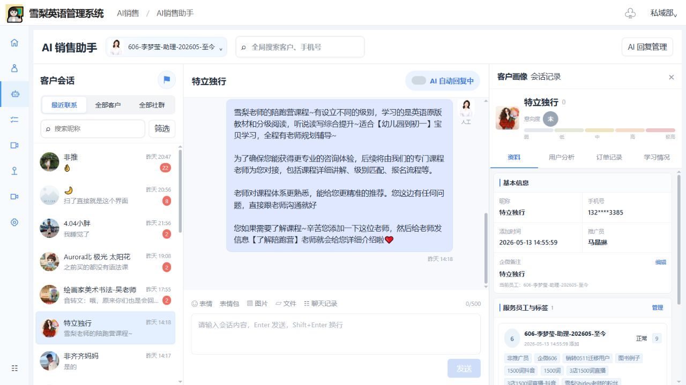
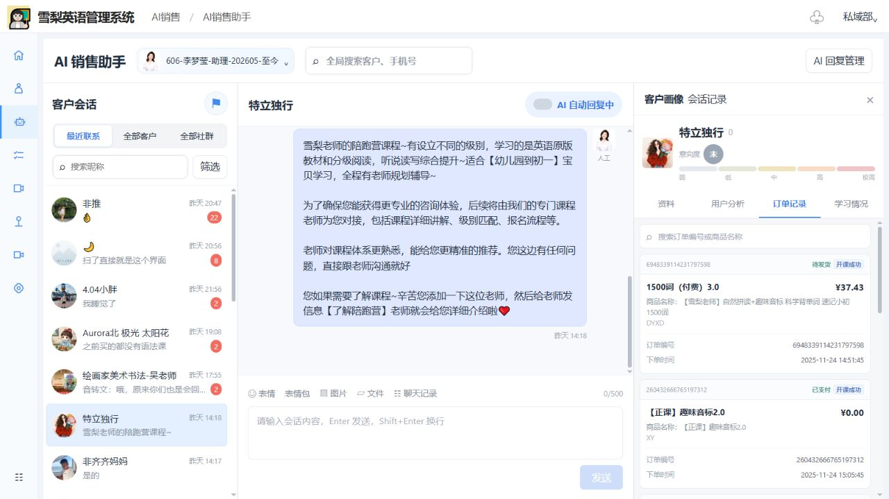
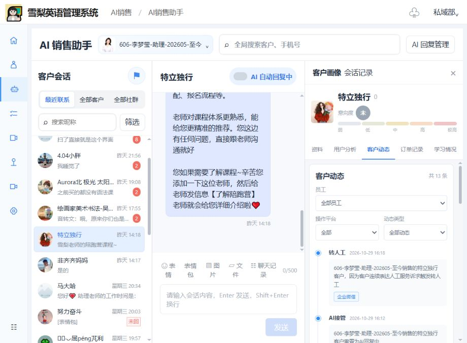

# AI销售助手侧边栏需求文档

以最初未改动的页面为基线，按当前复刻原型整理侧边栏开发需求。后续调整直接更新对应条目及原型图，以最新原型中的最终状态为准。

| 模块 | 需求说明 | 原型图 |
| --- | --- | --- |
| 客户画像－客户资料 | **展示客户基础信息及服务关系，方便销售快速了解客户。** 1. 顶部展示客户昵称、头像及意向度；基本信息包含昵称、手机号、添加时间、推广员和企微备注。 2. 资料页展示服务员工与标签、所在社群及消费汇总，支持编辑企微备注、管理标签。 |  |
| 订单记录－价格排序 | **客户全部订单按价格从高到低展示。** 1. 进入订单页或切换客户时，按全量订单价格降序排列，零元订单排在有价订单之后。 2. 同价订单按下单时间倒序排列，时间相同保持稳定顺序。 |  |
| 订单记录－订单卡片 | **课程名称作为卡片主标题，商品名称作为补充信息。** 1. 课程名称加粗展示，下方以常规字体展示“商品名称：原商品名称”，长名称按卡片宽度换行。 2. 同时展示价格、订单状态、来源、订单编号及下单时间；课程订单展示对应课程的最新开课状态。 |  |
| 订单记录－搜索 | **支持快速查找当前客户的订单。** 1. 输入订单编号或商品名称筛选订单，课程名称也参与匹配。 2. 搜索结果沿用价格排序；清空关键词后恢复全部订单，无匹配结果时展示空状态。 |  |
| 客户画像－客户动态入口 | **在右侧客户画像中新增“客户动态”标签页。** 1. 标签顺序为“资料、用户分析、客户动态、订单记录、学习情况”。 2. 点击后在侧栏内展示动态记录，顶部沿用客户摘要，记录区域独立滚动。 |  |
| 客户动态－筛选 | **支持按员工、操作平台和动态类型组合筛选。** 1. 员工默认“全部员工”，可选择当前客户关联的具体员工；操作平台包含全部、企业微信、微信自动同步、APP、直播间。 2. 任一条件变化后即时更新记录和数量，多个条件取交集；选择“全部”恢复对应维度的全部记录。 |  |
| 客户动态－动态类型 | **按业务类别筛选客户行为与服务记录。** 1. 提供全部动态、标签变动、好友关系变动、转人工变更、群聊变动、直播行为、公众号行为、交易记录。 2. 分别覆盖打标签/删除标签、添加好友/客户流失、转人工/AI接管、加入群聊/退出群聊、点击预约/进入直播间、关注公众号、下单产品/成交记录。 |  |
| 客户动态－事件时间线 | **按时间倒序展示客户动态及事件详情。** 1. 每条记录展示事件名称、发生时间、事件描述及操作平台；涉及员工操作或销售来源时，描述中带出员工与客户名称。 2. 转人工记录说明触发原因，AI接管记录说明回复状态变化；标签、群聊、课程或交易事件展示对应名称、行为或金额。 |  |
| 客户动态－销售来源关联 | **预约、进入直播间及加入群聊可关联来源销售，并参与员工筛选。** 1. 点击预约、进入直播间按“客户通过某销售的链接完成预约/进入指定直播间”描述；加入群聊按“客户通过某销售的邀请加入指定群聊”描述。 2. 以事件记录的来源销售为准展示姓名及归属，选择该员工时同步筛出这些动态；无销售归属的记录按客户行为描述。 |  |
| 客户动态－客户切换与空状态 | **动态记录与当前客户对应，筛选状态按客户独立保留。** 1. 切换客户时同步更新关联员工、动态记录及数量；返回原客户时恢复其筛选条件。 2. 客户无记录时显示“暂无客户动态”；组合筛选无结果时显示“当前筛选条件下暂无客户动态”，数量同步为0。 |  |
