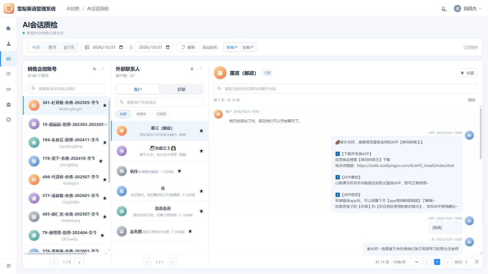

# AI 会话质检需求文档

> 本文档以当前 AI 会话质检原型为基线，只记录当前确认并需要持续维护的产品需求。

| 模块 | 需求说明 | 原型图 |
|---|---|---|
| 页面框架 | 提供与雪梨英语管理系统一致的 AI 会话质检工作台。 • 顶部展示系统名称、当前位置、通知和当前用户。 • 左侧提供主导航并高亮“AI 会话质检”。 |  |
| 时间与添加时间筛选 | 支持按指定时间范围和客户添加时间查看销售企微会话。 • 提供今天、昨天、近 7 天快捷选项，支持设置开始和结束日期并刷新结果。 • 选择客户时，在刷新按钮旁依次展示“添加时间：”、新客户和老客户；悬停新客户或老客户按钮时，提示对应的添加时间定义。 |  |
| 客户标签筛选 | 支持按企业微信标签组选择一个或多个客户标签并筛选客户。 • 标签组及标签名称沿用“企业微信标签管理”的数据口径，并显示标签组总数。 • 点击“客户标签”选择框打开左右结构筛选弹层，左侧展示标签组，右侧展示组内标签，两侧均支持按名称搜索。 • 支持全选或取消全选当前标签组；弹层顶部紧凑展示已选标签。确认后选择框展示前两个标签及剩余数量，悬停时显示完整标签。 • 同一标签组内按“或”匹配，不同标签组之间按“且”匹配；切换到群聊时不展示客户标签筛选。 | [查看原型](../index.html) |
| 销售企微账号 | 展示销售企微账号列表，并支持快速定位目标账号。 • 显示账号总数、头像、账号名称和企微 ID。 • 支持搜索、收藏、选择账号和列表翻页。 |  |
| 外部联系人 | 按客户和群聊两个大类展示当前销售账号关联的外部联系对象。 • 客户分类提供全部、未流失、已流失状态筛选；群聊分类提供全部、已解散状态筛选。 • 列表显示对应总数、头像、名称、最近消息和更新时间，并支持搜索、收藏、选择和翻页。 |  |
| 会话信息栏 | 展示当前客户信息并提供会话内容检索。 • 显示客户头像、名称、只读状态和收藏操作。 • 支持搜索当前时间范围内的聊天内容，并展示消息总数。 |  |
| 只读会话 | 以只读方式还原客户与销售侧的历史聊天记录。 • 客户消息在左侧展示，销售、AI 或 APP 消息在右侧展示。 • 每条消息显示发送方、来源、时间和消息内容，不提供输入或发送能力。 |  |
| 会话内容展示 | 支持在消息流中清晰展示不同类型和长度的内容。 • 文本保留换行、链接、表情和长内容结构。 • 消息区域独立滚动，当前选中客户的会话保持连续可读。 |  |
| 底部分页栏 | 在工作区底部集中提供各区域的翻页能力。 • 分别展示账号页码、客户页码和会话页码。 • 会话分页支持总条数、每页条数、上一页、下一页和页码跳转。 |  |
