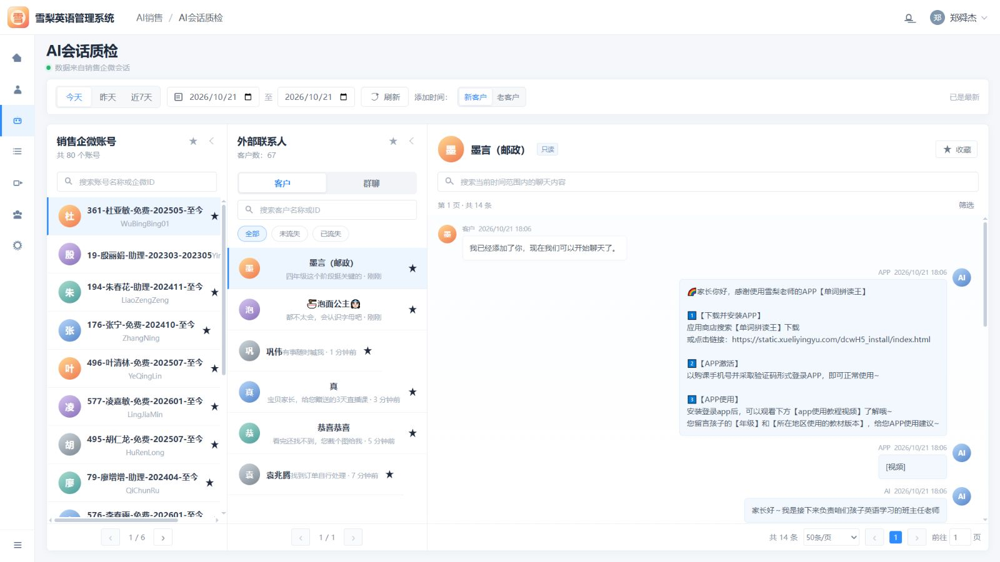
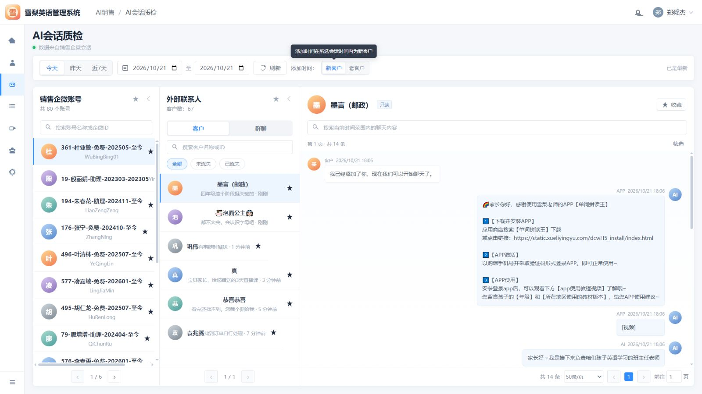

# AI 会话质检需求文档

> 本文档以当前 AI 会话质检原型为基线，只记录当前确认并需要持续维护的产品需求。

| 模块 | 需求说明 | 原型图 |
|---|---|---|
| 页面框架 | 提供与雪梨英语管理系统一致的 AI 会话质检工作台。 • 移除系统顶部栏及右上角通知、用户区域，使页面标题、筛选区和工作区整体上移并获得更大纵向空间。 • 左侧提供主导航并高亮“AI 会话质检”。 |  |
| 用户添加时间筛选 | 顶部时间控件用于按用户添加销售企微好友的时间筛选客户。 • 提供今天、昨天、近 7 天快捷选项，并支持自定义添加开始日期和结束日期。 • 客户标签紧邻时间筛选展示，刷新按钮独立靠筛选栏最右侧对齐；筛选群聊时不应用用户添加时间。 |  |
| 客户标签筛选 | 支持按企业微信标签组选择一个或多个客户标签并筛选客户。 • 标签组及标签名称沿用“企业微信标签管理”的数据口径，并显示标签组总数。 • 点击“客户标签”选择框打开左右结构筛选弹层，左侧展示标签组，右侧展示组内标签，两侧均支持按名称搜索。 • 支持全选或取消全选当前标签组；弹层顶部紧凑展示已选标签。确认后选择框展示前两个标签及剩余数量，悬停时显示完整标签。 • 同一标签组内按“或”匹配，不同标签组之间按“且”匹配；切换到群聊时不展示客户标签筛选。 | [查看原型](../index.html) |
| 销售企微账号 | 展示销售企微账号列表，并支持按销售区组快速定位目标账号。 • 显示账号总数、头像、账号名称和企微 ID，支持搜索、收藏、选择账号和列表翻页。 • 账号搜索下方提供销售区组树形筛选，层级与“区组销售管理”的团队、分区、小组保持一致，并展示各节点人数。 • 筛选入口持续显示当前选择的区组及层级；选择团队或分区时，展示该节点及全部下级节点的企微账号，选择小组时仅展示该小组账号。 • 标题栏提供收起按钮，收起后保留窄栏展开入口并释放空间给右侧会话区域。 |  |
| 外部联系人 | 按客户和群聊两个大类展示当前销售账号关联的外部联系对象。 • 客户分类提供全部、未流失、已流失状态筛选；群聊分类依次提供未解散、全部、已解散状态筛选。 • 列表显示对应总数、头像、名称、最近消息和更新时间，并支持搜索、收藏、选择和翻页。 • 标题栏提供收起按钮，收起后保留窄栏展开入口并释放空间给右侧会话区域。 |  |
| 会话信息栏 | 展示当前客户信息并提供会话内容检索。 • 在右侧聊天框顶部的当前客户名称旁直接展示会话时间范围筛选，样式与顶部用户添加时间筛选一致，支持今天、昨天、近 7 天和自定义起止日期。 • 右侧保留收藏和最早/最晚消息切换操作；搜索、历史加载及最早消息定位均使用当前会话时间范围。 |  |
| 只读会话 | 以只读方式还原客户与销售侧的历史聊天记录。 • 客户消息在左侧展示，销售、AI 或 APP 消息在右侧展示。 • 每条消息显示发送方、来源、时间和消息内容，不提供输入或发送能力。 |  |
| 会话内容展示 | 支持在消息流中清晰展示不同类型和长度的内容。 • 文本保留换行、链接、表情和长内容结构。 • 消息区域独立滚动，当前选中客户的会话保持连续可读。 |  |
| 历史消息加载与定位 | 会话记录按每批 50 条自然向上加载，不再使用分页。 • 进入会话先请求并展示最新 50 条；滚动到顶部时继续请求更早的 50 条并加入本地缓存，保持当前阅读位置，直到当前用户会话时间范围内的最早消息。 • 收藏按钮右侧初始提供“切换至最早消息”，加载全部历史后自动滚动至顶部并变为“切换至最晚消息”；再次点击回到最晚消息并恢复初始文案。 • 不提供会话右下角的独立滚动圆形按钮。 | [查看原型](../index.html) |
| 客户画像与客户动态 | 在最早/最晚消息切换按钮旁提供“客户动态”入口，点击后以无整页遮罩的客户画像抽屉从右向左平滑展开；聊天区同步自适应缩窄。 • 抽屉沿用 AI 销售助手侧边栏的信息结构，提供资料、用户分析、客户动态、订单记录、学习情况五个标签页；除筛选和标签页切换外，所有资料均为只读，不提供编辑、管理或发送入口。 • 用户分析按家庭概况、孩子、基本情况、学习经历、家庭学习情况和购买决策分层展示；孩子信息继续细分基本信息、上学情况、英语学习情况和课程情况，未识别字段统一显示“未提取到”。 • 客户动态保留完整的客户概要、员工标签视角和动态时间线；下方员工、操作平台、动态类型均支持多选组合筛选，未选择具体项时表示全部。 • 动态文案采用“员工—客户—动作”的主谓宾结构；点击预约、进入直播间和加入群聊记录对应销售，并说明客户通过该销售的链接或邀请完成动作。 • 直播行为包含点击预约、进入直播间、点击直播间商品链接、退出直播间和直播间发送内容；进入直播间额外展示观看直播时间，缺失时按 0 展示。 • 动态类型按业务动作聚合为标签变动、好友关系变动、转人工变更、群聊变动、直播行为、公众号行为和交易记录；转人工说明触发原因，AI 接管说明客户已重置为 AI 回复中。 • 操作平台保留筛选，并标注平台能否准确区分待技术确认。 | [查看原型](../index.html) |
| 客户流失状态 | 在右侧会话标题的客户名称与“会话时间”之间展示流失状态，并在客户动态概要的客户名称旁同步展示。 • 状态根据当前客户显示“未流失”或“已流失”，切换客户后同步更新。 | [查看原型](../index.html) |
| 底部分页栏 | 在工作区底部提供账号列表和客户列表的翻页能力。 • 分别展示账号页码和客户页码。 • 会话区域只显示已加载数量及上滑加载提示，不提供页码、每页条数或页码跳转。 |  |
